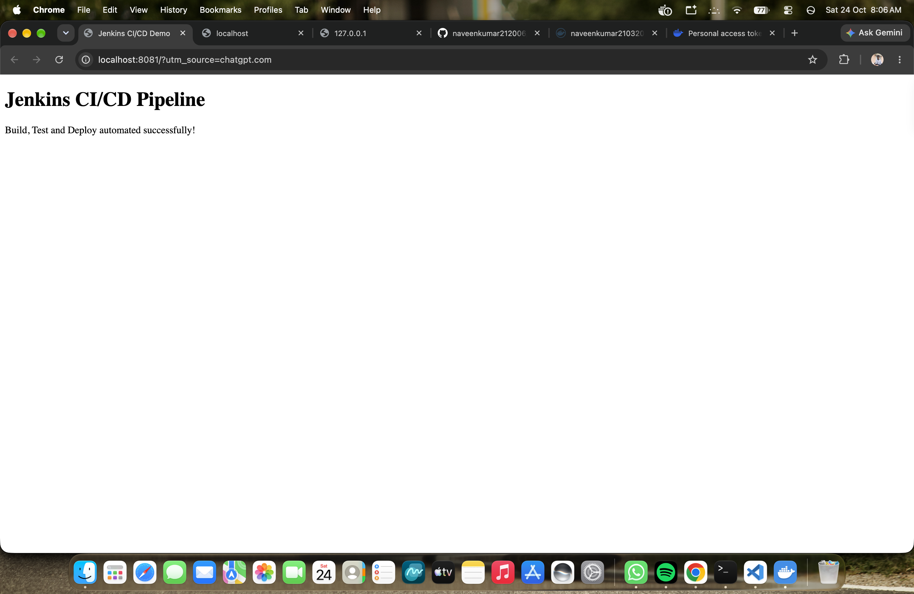

# 🚀 Jenkins CI/CD Pipeline with Docker

A simple **Continuous Integration and Continuous Deployment (CI/CD) pipeline** built using Jenkins and Docker. This project automates source code checkout, Docker image building, application testing, publishing the image to Docker Hub, and deploying the application in a Docker container.

## 📌 Project Overview

The goal of this project is to automate the process of building, testing, and deploying a web application using Jenkins Pipeline and Docker.

The application is a simple HTML website served using NGINX. Whenever the Jenkins pipeline runs, it checks out the source code, builds a Docker image, tests the application, pushes the image to Docker Hub, and deploys the container locally.

## 🏗️ Architecture

```text
Developer
    |
    v
GitHub Repository
    |
    v
Jenkins Pipeline
    |
    v
Build Docker Image
    |
    v
Test Application
    |
    v
Push Image to Docker Hub
    |
    v
Deploy Docker Container
    |
    v
Access Application
http://localhost:8081
```

## 🛠️ Technologies Used

| Technology | Purpose |
|---|---|
| Jenkins | CI/CD pipeline automation |
| Docker | Containerization |
| Docker Hub | Docker image registry |
| Git | Version control |
| GitHub | Source code hosting |
| NGINX | Web server |
| HTML | Web application |
| Groovy | Jenkins Pipeline syntax |
| Shell scripting | Pipeline automation |

## 📂 Project Structure

```text
jenkins-cicd-pipeline/
├── app/
│   └── index.html
├── screenshots/
│   └── application-output.png
├── Dockerfile
├── Jenkinsfile
└── README.md
```

### File Description

- `app/index.html` – Contains the web application's HTML page.
- `screenshots/application-output.png` – Screenshot of the deployed application.
- `Dockerfile` – Defines how the Docker image is built.
- `Jenkinsfile` – Defines the automated CI/CD pipeline.
- `README.md` – Project documentation.

## ⚙️ How It Works

The Jenkins pipeline contains the following stages:

### 1. Checkout

Retrieves the latest source code from the GitHub repository.

### 2. Check Docker

Verifies that Docker is installed and the Docker daemon is accessible.

### 3. Build Image

Builds the Docker image using the project's Dockerfile.

The image is tagged with the Jenkins build number and the `latest` tag.

```bash
docker build -t naveenkumar21032006/jenkins-cicd-app:latest .
```

### 4. Test Application

Starts a temporary container and checks whether the application responds successfully over HTTP.

The temporary test container is removed after a successful test.

### 5. Push to Docker Hub

Authenticates with Docker Hub using Jenkins credentials and pushes both the build-specific image and the `latest` image.

**Docker Hub Repository:**  
https://hub.docker.com/r/naveenkumar21032006/jenkins-cicd-app

### 6. Deploy Container

Removes the previous application container, if present, and starts the newly built image.

The application is exposed on port `8081` of the host machine.

## 🐳 Docker Configuration

The application uses NGINX to serve the HTML page.

Example Dockerfile:

```dockerfile
FROM nginx:alpine

COPY app/index.html /usr/share/nginx/html/index.html

EXPOSE 80
```

### Build the Docker Image Manually

```bash
docker build -t naveenkumar21032006/jenkins-cicd-app:latest .
```

### Run the Container Manually

```bash
docker run -d \
  --name jenkins-cicd-app \
  -p 8081:80 \
  naveenkumar21032006/jenkins-cicd-app:latest
```

### Verify the Running Container

```bash
docker ps
```

### View Container Logs

```bash
docker logs jenkins-cicd-app
```

### Stop the Container

```bash
docker stop jenkins-cicd-app
```

### Remove the Container

```bash
docker rm jenkins-cicd-app
```

## 🔐 Jenkins Credentials Setup

Configure the following credentials in Jenkins:

**GitHub Credential**
- Credential ID: `github-token`
- Used to access the GitHub repository when authentication is required.

**Docker Hub Credential**
- Credential ID: `dockerhub-creds`
- Username: Your Docker Hub username.
- Password: Docker Hub Personal Access Token with the required push permission.

Store tokens securely in Jenkins Credentials. Do not hardcode passwords or access tokens in the `Jenkinsfile` or commit them to GitHub.

## ▶️ How to Run the Project

### Prerequisites

- Git installed
- Docker Desktop installed and running
- Jenkins installed and running
- GitHub account and repository
- Docker Hub account

### Step 1: Clone the Repository

```bash
git clone https://github.com/naveenkumar212006/jenkins-cicd-pipeline.git
cd jenkins-cicd-pipeline
```

### Step 2: Configure Jenkins

1. Create a Pipeline job in Jenkins.
2. Configure the GitHub repository URL.
3. Select the `main` branch.
4. Ensure the repository contains the `Jenkinsfile`.
5. Configure the required Jenkins credentials.
6. Ensure Jenkins can access the Docker CLI and Docker daemon.

### Step 3: Run the Pipeline

Open the Jenkins dashboard, select the pipeline job, and click **Build Now**.

Review **Console Output** to monitor each stage.

### Step 4: Access the Application

After a successful deployment, open:

**http://localhost:8081**

## 📸 Application Output

The application screenshot will be displayed below when the screenshot file is added to the repository.



## 📦 Docker Hub Image

The Docker image is published to the following repository:

**Image:** `naveenkumar21032006/jenkins-cicd-app`

**Docker Hub:**  
https://hub.docker.com/r/naveenkumar21032006/jenkins-cicd-app

Pull the latest image:

```bash
docker pull naveenkumar21032006/jenkins-cicd-app:latest
```

Run it locally:

```bash
docker run -d \
  --name jenkins-cicd-app \
  -p 8081:80 \
  naveenkumar21032006/jenkins-cicd-app:latest
```

## 🧪 Verification

Use the following commands to verify the deployment:

```bash
docker ps
curl -I http://localhost:8081
docker logs jenkins-cicd-app
```

Expected results:

- The application container is running.
- The container port `80` is mapped to host port `8081`.
- The HTTP request returns a successful response.
- The application is accessible through the local browser.

## 🛠️ Troubleshooting

**Docker login fails**

- Verify the Docker Hub username.
- Update the `dockerhub-creds` Jenkins credential with a valid Personal Access Token.
- Confirm that the token has permission to push images.

**Application does not open**

- Ensure Docker Desktop is running.
- Run `docker ps -a` to inspect the container status.
- Check logs with `docker logs jenkins-cicd-app`.
- Verify that port `8081` is not being used by another process.

**Jenkins cannot find Docker**

- Ensure the Docker CLI is installed.
- Verify the Docker executable path in the Jenkins environment.
- Confirm that Jenkins can communicate with the Docker daemon.

**Image push fails**

- Check Docker Hub authentication.
- Verify the repository name and push permissions.
- Review the Jenkins Console Output for the exact error.

## 🎯 Learning Outcomes

Through this project, I gained hands-on experience with:

- Building automated CI/CD pipelines using Jenkins.
- Writing a declarative Jenkinsfile.
- Creating Docker images using a Dockerfile.
- Testing a containerized web application.
- Publishing Docker images to Docker Hub.
- Managing credentials securely in Jenkins.
- Deploying and troubleshooting Docker containers.
- Understanding the end-to-end CI/CD workflow.

## 🔮 Future Improvements

- Configure automatic pipeline triggers on GitHub pushes.
- Add automated unit and integration tests.
- Integrate SonarQube for code quality analysis.
- Add deployment to a remote cloud server such as AWS EC2.
- Implement monitoring and notifications for pipeline status.

## 👨‍💻 Author

**Naveen Kumar A.**

Aspiring DevOps Engineer

- **GitHub:** https://github.com/naveenkumar212006
- **Docker Hub:** https://hub.docker.com/u/naveenkumar21032006
- **LinkedIn:** https://www.linkedin.com/in/nk2103/

---

⭐ If you find this project useful, feel free to explore the repository and share your feedback.
